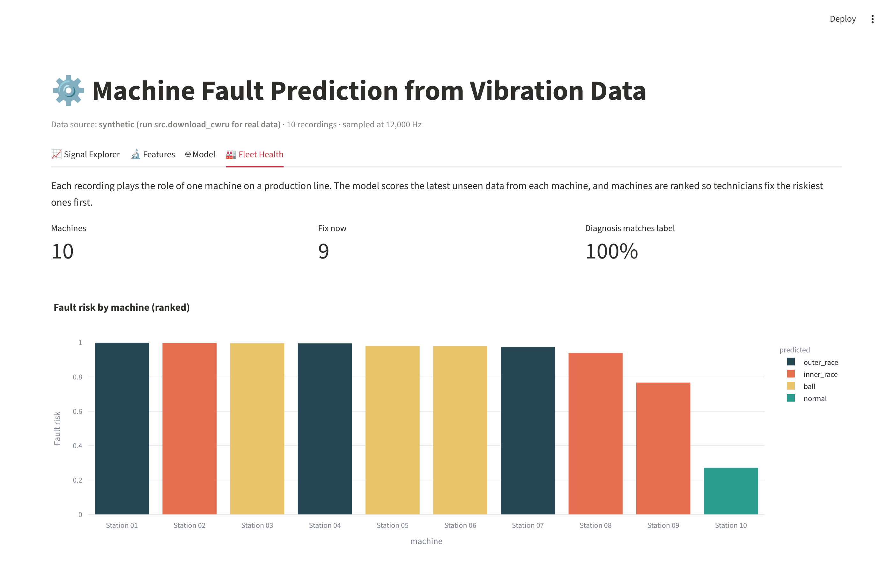
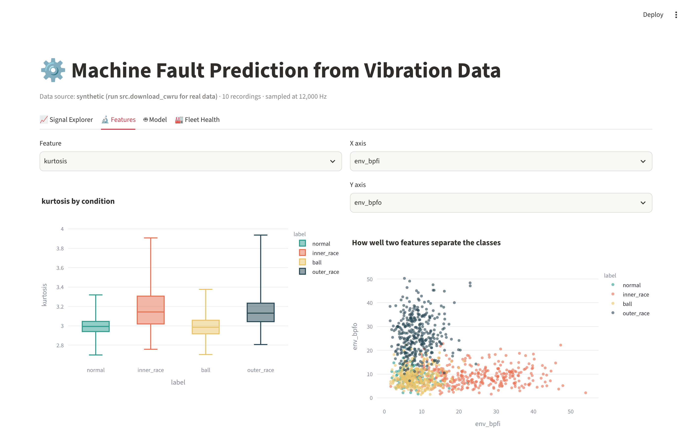
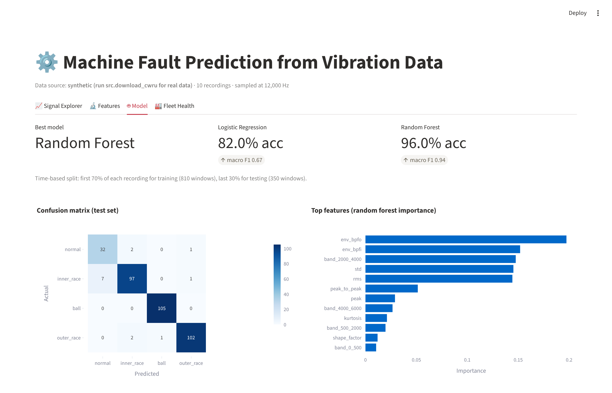

# ⚙️ Machine Fault Prediction from Vibration Data


Find failing bearings from accelerometer data, identify **which part** is failing, and rank machines
so maintenance fixes the riskiest ones first, all shown in an interactive dashboard.

> **Why I built this.** At Tesla I led a project that put wireless vibration sensors on Model 3
> assembly equipment and used machine learning to rank machine faults for technicians, which cut
> downtime by over 50%. That data is proprietary, so this repo recreates the same approach end to end
> with the public [CWRU Bearing Data Center](https://engineering.case.edu/bearingdatacenter) dataset.



## What it does

```
 accelerometer  ─►  windowing  ─►  feature engineering  ─►  classifier  ─►  fleet risk ranking
  (12 kHz)          2048 samples    time · FFT bands ·       random forest    🔴 fix now
                    50% overlap     envelope @ BPFI/BPFO/BSF  vs. logistic    🟡 plan repair
                                                               regression      🟢 monitor
```

1. **Signal processing:** FFT spectrum and **envelope analysis**: band-pass around the structural
   resonance, Hilbert envelope, then spectrum. Peaks at the bearing defect frequencies
   (BPFI 162 Hz, BPFO 107 Hz, BSF 71 Hz at 1797 rpm) show *where* the defect is.
2. **Feature engineering:** 17 features per window: RMS, kurtosis, crest/impulse/shape factor,
   band energies, spectral centroid, and envelope amplitude at each defect frequency.
3. **Modeling:** Random forest compared with a logistic regression baseline. Uses a
   **time-based split** (first 70% of each recording trains, last 30% tests), because overlapping
   windows from the same recording would leak into a random split and inflate accuracy.
4. **Dashboard (Streamlit + Plotly):** signal explorer, feature comparison, model results, and a
   fleet view that ranks machines by fault risk.

## Dashboard

| Signal explorer | Features |
|---|---|
|  |  |
| **Model results** | **Fleet health** |
|  |  |

## Quick start

```bash
git clone https://github.com/hregmi77/machine-fault-prediction.git
cd machine-fault-prediction
python -m venv .venv && source .venv/bin/activate   # Windows: .venv\Scripts\activate
pip install -r requirements.txt

python -m src.download_cwru      # ~10 recordings from CWRU (optional, see below)
python -m src.train              # builds features, trains, saves models/ and metrics
streamlit run app/dashboard.py   # opens http://localhost:8501
```

**No download? It still runs.** If the CWRU files aren't in `data/raw/`, the project generates
physics-based synthetic vibration: impacts at the real defect frequencies ringing a ~3 kHz
resonance, plus noise. The dashboard labels which source it's using.

## Results

| Data | Model | Accuracy | Macro F1 |
|---|---|---|---|
| Synthetic | Logistic regression | 82.0% | 0.67 |
| Synthetic | **Random forest** | **96.0%** | **0.94** |
| CWRU (12k drive end, 0 HP) | Random forest | *run `src.train` and add yours* | |

The most important features are the envelope amplitudes at BPFO and BPFI, which matches the physics:
the model learns to listen for impacts at the defect frequency, not just "more vibration."

## Project structure

```
├── app/dashboard.py        Streamlit dashboard (4 tabs)
├── src/
│   ├── config.py           sampling rate, bearing geometry, defect frequencies, file list
│   ├── download_cwru.py    fetches the CWRU .mat files
│   ├── simulate.py         synthetic bearing-fault vibration generator
│   ├── data.py             loads recordings, windows signals
│   ├── features.py         time, frequency, and envelope features
│   └── train.py            time-based split, model comparison, saves model + metrics
├── tests/                  pytest unit tests (feature math, envelope detection)
└── .github/workflows/ci.yml  runs tests and a training pass on every push
```

## Ideas for next steps

- Severity regression (0.007 / 0.014 / 0.021 in defect size) and remaining-useful-life trend
- Test on other motor loads (1–3 HP) to check the model generalizes
- Stream live data from a USB accelerometer or MQTT and score it in real time

## Data credit

Case Western Reserve University Bearing Data Center. Data used for research and education.

---
Built by **Hem Regmi**: controls and test engineer (Stanadyne, Tesla) · [GitHub](https://github.com/hregmi77) · [LinkedIn](https://linkedin.com/in/hregmi)
