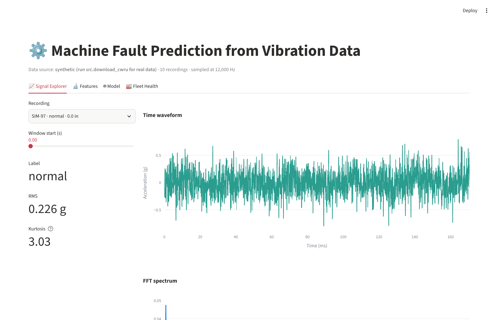

# ⚙️ Machine Fault Prediction from Vibration Data


[](https://hregmi77-fault-prediction.streamlit.app)

**▶ Try it live: [hregmi77-fault-prediction.streamlit.app](https://hregmi77-fault-prediction.streamlit.app)** (no install needed)

Find failing bearings from accelerometer data, identify **which part** is failing, and rank machines
so maintenance fixes the riskiest ones first, all shown in an interactive dashboard.

> **Why I built this.** At Tesla I led a project that put wireless vibration sensors on Model 3
> assembly equipment and used machine learning to rank machine faults for technicians, which cut
> downtime by over 50%. That data is proprietary, so this repo recreates the same approach end to end
> with the public [CWRU Bearing Data Center](https://engineering.case.edu/bearingdatacenter) dataset.


## What it does

```
 accelerometer  ─►  windowing  ─►  feature engineering  ─►  classifier  ─►  fleet risk ranking
  (12 kHz)          2048 samples    time · FFT bands ·       random forest    🔴 fix now
                    50% overlap     envelope @ BPFI/BPFO/BSF  vs. logistic    🟡 plan repair
                                                               regression      🟢 monitor
```

1. **Signal processing:** FFT spectrum and **envelope analysis**: band-pass around the structural
   resonance, Hilbert envelope, then spectrum. Peaks at the bearing defect frequencies
   (BPFI 162 Hz, BPFO 107 Hz, BSF 71 Hz at 1797 rpm) show *where* the defect is.
2. **Feature engineering:** 17 features per window: RMS, kurtosis, crest/impulse/shape factor,
   band energies, spectral centroid, and envelope amplitude at each defect frequency.
3. **Modeling:** Random forest compared with a logistic regression baseline. Uses a
   **time-based split** (first 70% of each recording trains, last 30% tests), because overlapping
   windows from the same recording would leak into a random split and inflate accuracy.
4. **Dashboard (Streamlit + Plotly):** signal explorer, feature comparison, model results, and a
   fleet view that ranks machines by fault risk.

## Dashboard

| Signal explorer | Features |
|---|---|
|  |  |
| **Model results** | **Fleet health** |
|  |  |

## Quick start

```bash
git clone https://github.com/hregmi77/machine-fault-prediction.git
cd machine-fault-prediction
python -m venv .venv && source .venv/bin/activate   # Windows: .venv\Scripts\activate
pip install -r requirements.txt

python -m src.download_cwru      # ~10 recordings from CWRU (optional, see below)
python -m src.train              # builds features, trains, saves models/ and metrics
streamlit run app/dashboard.py   # opens http://localhost:8501
```

**No download? It still runs.** If the CWRU files aren't in `data/raw/`, the project generates
physics-based synthetic vibration: impacts at the real defect frequencies ringing a ~3 kHz
resonance, plus noise. The dashboard labels which source it's using.

## Results

| Data | Model | Accuracy | Macro F1 |
|---|---|---|---|
| Synthetic | Logistic regression | 82.0% | 0.67 |
| Synthetic | **Random forest** | **96.0%** | **0.94** |
| CWRU (12k drive end, 0 HP) | Random forest | *run `src.train` and add yours* | |

The most important features are the envelope amplitudes at BPFO and BPFI, which matches the physics:
the model learns to listen for impacts at the defect frequency, not just "more vibration."

## Deploy your own live demo

The dashboard runs on [Streamlit Community Cloud](https://share.streamlit.io) for free. On first launch it
downloads the CWRU data and trains the model by itself (about a minute), then caches the result.

1. Sign in to share.streamlit.io with GitHub, then choose **Create app → Deploy a public app from GitHub**.
2. Repository `hregmi77/machine-fault-prediction`, branch `main`, main file `app/dashboard.py`.
3. Under **Advanced settings**, pick Python 3.11. Under **App URL**, enter `hregmi77-fault-prediction`.
4. Click **Deploy**.

## Project structure

```
├── app/dashboard.py        Streamlit dashboard (4 tabs); trains on first launch if needed
├── src/
│   ├── config.py           sampling rate, bearing geometry, defect frequencies, file list
│   ├── download_cwru.py    fetches the CWRU .mat files
│   ├── simulate.py         synthetic bearing-fault vibration generator
│   ├── data.py             loads recordings, windows signals
│   ├── features.py         time, frequency, and envelope features
│   └── train.py            time-based split, model comparison, saves model + metrics
├── tests/                  pytest unit tests (feature math, envelope detection)
└── .github/workflows/ci.yml  runs tests and a training pass on every push
```

## Ideas for next steps

- Severity regression (0.007 / 0.014 / 0.021 in defect size) and remaining-useful-life trend
- Train on 0 hp and test on 1–3 hp (files 106–108, 119–121, 131–133, ...) to check that the model generalizes across load and speed
- Stream live data from a USB accelerometer or MQTT and score it in real time

## Dataset: CWRU Bearing Data Center

Real vibration data from the [Case Western Reserve University Bearing Data Center](https://engineering.case.edu/bearingdatacenter),
one of the most widely used benchmarks for motor bearing fault diagnosis.

**Test rig.** A 2 hp electric motor drives a shaft supported by the test bearings. A torque
transducer/encoder in the middle measures speed and power, and a dynamometer on the far end applies
load (0–3 hp). Accelerometers on magnetic bases sit on the motor housing at the drive end and fan end.

**Seeded faults.** Single-point defects were cut into SKF 6205-2RS deep-groove ball bearings with
electro-discharge machining (EDM), at the **inner race**, a **ball**, or the **outer race**, in
diameters of 0.007", 0.014", and 0.021" (0.028" and 0.040" on equivalent NTN bearings).

**Signals.** MATLAB `.mat` files, about 10 s each, sampled at **12 kHz** (drive-end faults also at 48 kHz):
`DE` drive-end accelerometer (used here), `FE` fan-end accelerometer, `BA` base accelerometer, `RPM`.

**Operating conditions.**

| Motor load | Shaft speed | Shaft frequency |
|---|---|---|
| 0 hp | 1797 rpm | 29.95 Hz |
| 1 hp | 1772 rpm | 29.53 Hz |
| 2 hp | 1750 rpm | 29.17 Hz |
| 3 hp | 1730 rpm | 28.83 Hz |

**Files used in this project** (12 kHz drive end, 0 hp, 1797 rpm; downloaded by `src/download_cwru.py`):

| Condition | 0.007" | 0.014" | 0.021" |
|---|---|---|---|
| Normal baseline | 97 | – | – |
| Inner race | 105 | 169 | 209 |
| Ball | 118 | 185 | 222 |
| Outer race (centered @ 6:00) | 130 | 197 | 234 |

**Bearing defect frequencies** (SKF 6205, multiples of shaft speed; values at 1797 rpm):

| Defect | Multiplier | Frequency |
|---|---|---|
| BPFI: inner race | 5.4152 × | 162.2 Hz |
| BPFO: outer race | 3.5848 × | 107.4 Hz |
| BSF: ball spin | 2.3570 × | 70.6 Hz |

A defect produces a short impact each time a rolling element passes it, so the envelope spectrum
shows a peak at that part's defect frequency. That's why `env_bpfo` and `env_bpfi` are the model's
top features.

**Limitations (and how this project handles them).**
- Faults are artificially seeded on a lab rig, not natural wear, so real-plant data is noisier.
- There's one ~10 s recording per condition, so overlapping windows are highly correlated. A random
  train/test split would leak and overstate accuracy, so this project uses a **time-based split**
  (first 70% of each recording trains, last 30% tests).
- Only one load (0 hp) is used. Training on one load and testing on another is the natural next test.

Data © Case Western Reserve University, provided for research and education. Cite as:
*Case Western Reserve University Bearing Data Center, https://engineering.case.edu/bearingdatacenter.*

---
Built by **Hem Regmi**: controls and test engineer (Stanadyne, Tesla) · [GitHub](https://github.com/hregmi77) · [LinkedIn](https://linkedin.com/in/hregmi)
